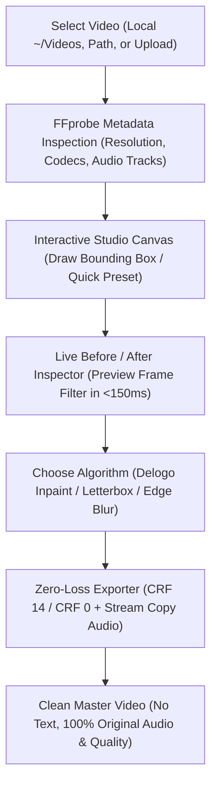

# 🎬 VIDO — Studio Zero-Loss Video Text & Watermark Remover

> **A studio-grade web application to remove overlaid text, website banners, watermarks, and burned-in subtitles from videos without sacrificing video or audio quality.**

---

## 🌟 Key Highlights

- **✨ Zero Quality Loss Guarantee**:
  - **Visually Lossless (CRF 14)**: Indistinguishable from the original source master with identical color science, bit depth, and frame rate.
  - **Mathematically Lossless (CRF 0)**: Bit-exact pixel preservation outside the masked text region.
  - **100% Audio Stream Copy (`-c:a copy`)**: Direct bitstream copy of all audio tracks without re-encoding (Dolby Atmos, 5.1 EAC3, DTS-HD, AAC, multi-lingual audio).
  - **Subtitle & Chapter Copy (`-c:s copy`)**: Preserves all embedded soft subtitle streams and chapter markers.
- **🎯 3 Removal Algorithms**:
  1. **Smart Delogo & Inpainting**: Smoothly interpolates surrounding scene pixels into the text area for active live motion scenes.
  2. **Cinema Letterbox Restore**: Restores pure `#000000` deep black for watermarks situated in top or bottom cinema aspect bars.
  3. **Edge Blur & Gaussian Smoothing**: Dynamic spatial smoothing with customizable radius for translucent watermarks.
- **🖌️ Interactive Studio Canvas**:
  - Scrub through video frames with a smooth timeline slider.
  - Click & drag to draw custom bounding boxes over text.
  - Move, scale, and adjust resize handles directly on the video canvas.
  - Quick 1-click presets: *Top Banner Strip (Wide)*, *Top-Left Watermark*, *Top-Right Logo*, *Cinema Top Bar*, *Cinema Bottom Bar*, *Subtitle Strip*.
- **🔍 Live Before / After Comparison Inspector**:
  - Split-screen draggable slider to compare the original video frame against the text-cleaned frame before rendering the full video.
  - Side-by-side mode.
- **⚡ Direct Local File Streaming**:
  - Instantly loads large 4K and 1080p video files (9GB – 30GB+) directly from your local folders (`~/Videos`, `~/Downloads`) without slow web uploads.
  - Standard file drag-and-drop and file picker also supported.
- **📊 Real-Time Encoding Progress**:
  - Live Server-Sent Events (SSE) monitor showing percentage, encoding FPS, speed multiplier (e.g. 3.2x), current timestamp, and time remaining (ETA).
- **🚀 One-Click Demo Mode**:
  - Instant demo clip generator creates a 1080p sample video with simulated movie scenery, top website banner, and subtitles so you can test all features right away.

---

## 🛠️ Architecture & Technologies

- **Frontend**: Vanilla HTML5, modern CSS3 (sleek dark aesthetic, glassmorphism, responsive grid), Vanilla JavaScript Canvas 2D overlay engine.
- **Backend**: Node.js 22 (Express, native child_process, HTTP 206 Partial Content Range streaming).
- **Processing Core**: System FFmpeg 62 with `delogo`, `drawbox`, `gblur`, `libx264`, and `ffprobe`.

---

## 🚀 Quickstart

### Prerequisites
Make sure **Node.js** and **FFmpeg** are installed on your system:
```bash
ffmpeg -version
node -v
npm -v
```

### Installation
```bash
# Clone the repository
git clone https://github.com/Gurunath-S/vido.git
cd vido

# Install dependencies
npm install

# Start the studio server
npm start
```

Open your browser at **[http://localhost:3000](http://localhost:3000)**.

---

## 📖 How It Works



1. **Load Video**: Pick any local file from the quick chips, paste a path, or click **Load Demo Clip**.
2. **Draw Removal Zone**: Drag a box over the text/watermark at the top of the video or pick **⚡ Top Banner Strip**.
3. **Compare Before / After**: Click **Compare Before / After** to inspect the live preview frame with the split slider.
4. **Export**: Click **Export Zero-Loss Video** and monitor live progress!

---

## 📄 License
MIT License. Created by Gurunath-S.
